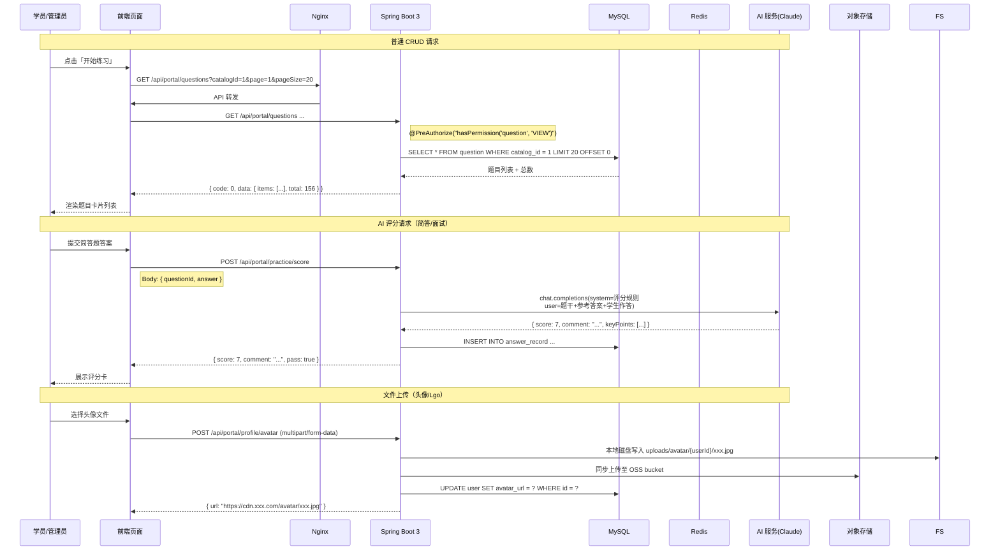
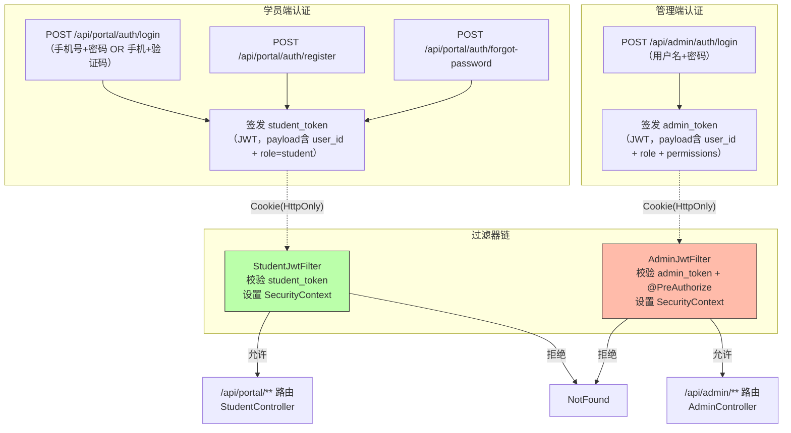
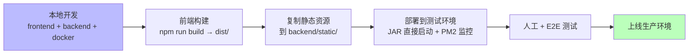

# 云枢智学 — 整体架构设计（V1.0）

> 编制日期：2026-11-09  
> 阶段：需求与设计 · 第二阶段  
> 依据：`docs/design/01.功能模块梳理.md`、已确认的 7 项决策（D1–D7）及本轮确认结果

---

## 一、技术选型

### 1.1 前端技术栈

| 层次 | 选型 | 版本目标 | 选型依据 |
|------|------|---------|----------|
| 框架 | **Vue 3** | ^3.4 | Composition API 适合面试对话、答题卡状态管理等复杂交互场景；国内生态最成熟 |
| 语言 | **TypeScript** | ^5.3 | 强类型约束减少运行时错误；与数据结构设计天然契合 |
| 构建工具 | **Vite** | ^5.x | 极速 HMR，开发体验优秀；插件生态完整 |
| UI 组件库 | **Element Plus** | ^2.7 | 开箱即用的后台管理组件（表格、树形权限配置、导入导出弹窗），与管理端高频组件匹配度高 |
| 路由 | **Vue Router** | ^4.x | Vue 官方路由，支持嵌套路由和路由守卫（权限拦截） |
| 状态管理 | **Pinia** | ^2.x | Vue 官方推荐，轻量级，适合学员练习会话、面试状态等场景的全局存储 |
| 样式方案 | CSS 变量 + Scoped Style | — | 保留原型中已有的 CSS 变量体系，便于主题切换（学科颜色等） |
| HTTP 客户端 | **Axios** | ^1.6 | 请求拦截器统一处理 Token、频控错误码；响应拦截器统一错误提示 |
| 图表库 | **ECharts** | ^5.x | 折线图/饼图/环形图等报表需求全覆盖；原型 README 已有建议 |
| 文件处理 | **xlsx (SheetJS)** | ^0.18 | Excel 解析/生成的标准 JS 库，用于管理端导入预览与导出 |

### 1.2 后端技术栈

| 层次 | 选型 | 版本目标 | 选型依据 |
|------|------|---------|----------|
| 运行时 | **JDK 17+ LTS** | 21 | 企业级稳定性；与 Spring Boot 3 LTS 完美匹配 |
| 框架 | **Spring Boot 3** | ^3.2 | 企业级标准；自动配置、starter 生态完善；原生支持 JWT、Redis、Schedule 等组件 |
| ORM / 数据访问 | **MyBatis（原生）** | ^3.5 | 手动控制 SQL，灵活度高；XML 映射文件便于复杂查询维护和审计 |
| 验证层 | **Hibernate Validator** | — | Jakarta EE Bean Validation 标准；Spring Boot 内置支持，配合自定义校验注解即可 |
| 认证方案 | **JWT + HttpOnly Cookie** | — | 同域名部署下 Cookie 传输最安全；HttpOnly 防 XSS；Refresh Token 双机制延长有效会话 |
| AI 服务封装 | **OpenAI Compatible SDK** | — | Claude 3.5 Sonnet 提供 OpenAI 兼容接口；后续切换模型供应商不影响业务代码 |
| Excel 处理 | **easyexcel (阿里)** | ^3.2 | 业界主流 Java Excel 库；低内存占用（流式读取）；支持复杂表头和多 Sheet |
| 文件存储 | **Local + MinIO/OSS 双写** | — | 首期本地磁盘 + OSS/S3 双写兜底；FileService 抽象层预留 upload() 接口签名 |
| 定时任务 | **Spring Schedule + cron** | — | 配额重置在 CST 0:00 触发；天然集成到 Spring 容器生命周期 |
| 日志 | **SLF4J + Logback** | — | Spring Boot 默认日志框架；结构化输出便于 ELK 采集 |
| 缓存 | **Spring Data Redis** | — | 与 Spring 生态无缝集成；频控计数器、登录锁、面试会话缓存统一管理 |
| Swagger API 文档 | **springdoc-openapi** | — | 自动生成 RESTful 接口文档 |

### 1.3 基础设施

| 层次 | 选型 | 说明 |
|------|------|------|
| 数据库 | **MySQL** | ^8.0 | JSON 列支持题目选项/标签等半结构化数据；InnoDB MVCC 并发好；企业级稳定 |
| 缓存 / 会话 | **Redis** | ^7.x | JWT 黑名单、登录锁、频控计数器、面试会话缓存（未完成的面试断点恢复） |
| 对象存储 | **MinIO / 阿里云 OSS** | — | 图片、Excel 临时文件上传；首期双写策略保障数据安全 |
| 反向代理 | **Nginx** | 同域名 `/portal/` 和 `/admin/` 静态文件由 Nginx 直接 serving，API 请求转发至 Spring Boot |
| 服务器 | Linux（Ubuntu 22.04 LTS） | Java 生态主流运行环境 |
| 部署方式 | Docker Compose（开发） / JAR 直启（生产） | 开发期 MySQL + Redis + MinIO 一键启动；生产期 Spring Boot 独立进程托管 |

### 1.4 决策对比（为何选择 Spring Boot + MyBatis 而非原方案 NestJS）

```
                    NestJS          Spring Boot 3
                    ───────         ────────────
企业级稳定性        ███████░░░       █████████░  （Java 生态久经考验）
ORM 灵活度          ██████░░░░       █████████░  （原生 MyBatis SQL 可控性更强）
前端协同           ████████░░       ███████░░░   （Node.js 全栈 TS 一致）
团队熟悉度         ███████░░░       █████████░   （Java 开发者更熟悉）
┌──────────────────────────────────────────────────┐
│ 综合结论：Spring Boot 3 + MyBatis（原生）+ MySQL │
│ 保持 SQL 完全可控，同时保证企业级稳定性           │
└──────────────────────────────────────────────────┘
```

---

## 二、整体架构设计

### 2.1 系统总体架构图

```mermaid
graph TB
    subgraph Browser["🌐 浏览器（同一域名）"]
        PortalFE["学员端前端<br/>Vue 3 + TS + Vite<br/>Element Plus"]
        AdminFE["管理端前端<br/>Vue 3 + TS + Vite<br/>Element Plus"]
    end

    subgraph Nginx["Nginx 反向代理"]
        RouteStatic["静态资源直出<br/>/portal/* → portal-dist/<br/>/admin/* → admin-dist/"]
        RouteAPI["API 转发<br/>/api/* → Spring Boot"]
    end

    subgraph Backend["Spring Boot 3 应用"]
        subgraph Gateway["网关层"]
            AuthFilter["JWT 过滤器<br/>学员端 / 管理端独立 Token"]
            RateLimitAspect["频控切面<br/>IP + 账号维度注解驱动"]
        end

        subgraph Controllers["控制层<br/>PortalController / AdminController"]
            P_C["M01 账户认证<br/>P_M04 题库<br/>P_M08 刷题<br/>P_M09 错题<br/>P_M10 面试<br/>P_M11 统计"]
            A_C["M02 RBAC<br/>M03 学科<br/>M04 题库<br/>M05 面试题库<br/>M06 课程<br/>M07 路线<br/>M12 设置<br/>M13 日志"]
        end

        subgraph Services["服务层<br/>各业务 ServiceImpl"]
            S1[M01 账户服务]
            S2[M02 权限服务]
            S3[M03 学科阶段服务]
            S4[M04 题库服务]
            S5[M05 面试题库服务]
            S6[M06 课程服务]
            S7[M07 学习路线服务]
            S8[M08 刷题练习服务]
            S9[M09 错题管理服务]
            S10[M10 AI面试服务]
            S11[M11 学习统计服务]
            S12[M12 系统设置服务]
            S13[M13 操作日志服务]
            S14[M14 文件存储服务]
            S15[M15 定时任务服务]
        end

        subgraph SharedServices["共享服务层"]
            AIService["AI 服务<br/>Claude 3.5 Sonnet<br/>简答题批改 + 面试评分 + 报告生成"]
            CacheService["缓存服务<br/>Spring Data Redis<br/>频控/会话/计数"]
        end
    end

    subgraph Infra["基础设施层"]
        MySQL["MySQL 8.0<br/>主数据库"]
        RedisS["Redis 7.x<br/>缓存 / 会话 / 频控"]
        FS["文件系统<br/>头像 / Logo / Excel 临时"]
        OSS["对象存储<br/>MinIO / 阿里云 OSS<br/>（双写策略）"]
    end

    subgraph External["外部服务"]
        LLM["Claude 3.5 Sonnet API<br/>（OpenAI 兼容接口）"]
        Bilibili["B站视频页<br/>（仅跳转，无接口调用）"]
        SMS["腾讯云短信 API"]
    end

    PortalFE --> Nginx
    AdminFE --> Nginx
    Nginx --> RouteStatic
    Nginx --> RouteAPI
    RouteAPI --> Gateway
    Gateway --> AuthFilter
    AuthFilter --> RateLimitAspect
    RateLimitAspect --> P_C & A_C
    P_C --> S1 & S4 & S8 & S9 & S10 & S11
    A_C --> S2 & S3 & S4 & S5 & S6 & S7 & S12 & S13
    S8 -.AI评分.-> AIService
    S10 -.AI评分.-> AIService
    S10 -.报告生成.-> AIService
    AIService --> LLM
    S1 & S2 & S3 & S4 & S5 & S6 & S7 & S8 & S9 & S10 & S11 & S12 & S13 & S14 --> MySQL
    S1 & S2 & S3 & S4 & S5 & S6 & S7 & S8 & S9 & S10 & S11 & S12 & S13 & S14 & S15 --> RedisS
    S14 --> FS
    S14 --> OSS
    S1 --> SMS
```



### 2.2 前后端通信模式



### 2.3 分层职责说明

| 层级 | 职责 | 关键技术 |
|------|------|----------|
| **前端表现层** | 路由/页面渲染、用户交互、本地状态（Pinia）、请求发送 | Vue 3 Composition API, Pinia, Axios |
| **网关层** | Token 校验、路径分发、全局异常处理、频控注解拦截 | JWT Filter, AOP 切面, `@RateLimited` |
| **控制层（Controller）** | HTTP 端点暴露、参数接收与校验、响应格式化 | `@RestController`, `@Validated`, DTO |
| **服务层（Service）** | 核心业务逻辑封装，事务管理，跨模块协作 | `@Service`, `@Transactional` |
| **数据访问层（Mapper）** | SQL 执行、ORM 映射、复杂查询组装 | MyBatis `@Select` / XML 映射文件 + 自定义分页拦截器 |
| **实体层（Entity）** | 数据库表映射（`@TableName`、`@TableId` 注解可选） | MyBatis MapStruct 或手动映射 |
| **共享服务层** | 跨模块复用的能力：AI 调用、缓存封装、OSS 上传 | 独立 Service Bean |
| **基础设施层** | MySQL 持久化、Redis 缓存/会话/频控、对象存储 | Docker Compose 一键启动开发环境 |

---

## 三、模块架构设计

### 3.1 模块在系统内的位置与依赖关系

```mermaid
graph LR
    subgraph Auth["认证与授权基础"]
        A1[M01 账户认证<br/>注册/登录/找回密码/SMS]
        A2[M02 权限控制<br/>RBAC 9组33项]
    end

    subgraph Content["内容管理层（管理端为主）"]
        C1[M03 学科与阶段]
        C2[M06 课程管理<br/>BV号唯一 + Excel导入]
        C3[M04 题库管理<br/>审核工作流]
        C4[M05 面试题库管理]
        C5[M07 学习路线<br/>课程编排 + 进度]
    end

    subgraph Learning["学习业务层（学员端为主）"]
        L1[M08 刷题与练习<br/>会话管理 + 判定]
        L2[M09 错题管理<br/>等级计算 + 纠正追踪]
        L3[M10 AI模拟面试<br/>逐题评分 + 报告]
        L4[M11 学习统计<br/>连续天数 + 正确率]
    end

    subgraph System["系统支撑层"]
        S1[M12 系统设置]
        S2[M13 操作日志]
        S3[M14 文件服务<br/>头像/Logo/OSS双写]
        S4[M15 定时任务<br/>配额重置]
    end

    subgraph AI["AI服务层（独立）"]
        AI1[AI评分服务<br/>Claude 3.5 Sonnet]
        AI2[报告生成服务]
    end

    A1 --> A2
    A1 --> L1 & L2 & L3 & L4
    A2 --> C1 & C2 & C3 & C4 & C5 & S1 & S2

    C1 -- "阶段ID" --> C3
    C2 -- "课程数据" --> C5
    C3 -- "上架题目" --> L1
    C4 -- "面试题库数据" --> L3

    L1 -- "答题结果" --> L2
    L1 -- "简答题分数" --> AI1
    L3 -- "每题评分" --> AI1
    L3 -- "面试汇总" --> AI2
    L2 -- "薄弱知识点" --> L3

    L4 --> C3 & C4 & L1 & L3
    S2 --> A2
    S3 --> A1  %% 头像上传属于 M01 流程

    style AI1 fill:#f9f,stroke:#333
    style AI2 fill:#f9f,stroke:#333
    style A1 fill:#bbf,stroke:#333
    style A2 fill:#bbf,stroke:#333
```

### 3.2 Spring Boot + MyBatis 后端包结构映射

后端采用 **Spring Boot 3 + MyBatis** 标准分层架构，按业务域拆分为独立模块（Maven 多模块工程），各模块内遵循 Controller → Service → Mapper → Domain 的经典四层结构。

```
backend/                                    # Maven 多模块父工程
├── pom.xml                                 # 父 POM（dependencyManagement 统一管理版本）
├── yunshu-common/                          # 公共模块（工具类、常量、异常处理）
│   ├── core/                               # 核心类（BaseEntity, PageQuery, TableDataInfo）
│   ├── config/                             # 配置类（Redis, OSS, AI Client, SMS）
│   ├── enums/                              # 通用枚举（状态码、类型、难度等）
│   ├── exception/                          # 全局异常处理（@ControllerAdvice）
│   ├── annotation/                         # 自定义注解（@RateLimited, @LogOperation）
│   └── util/                               # 工具类（DateUtil, EncryptUtil, JwtUtil...）
├── yunshu-framework/                       # 框架层模块（安全与拦截器）
│   ├── security/                           # Spring Security 配置
│   │   ├── StudentJwtFilter.java           # 学员端 JWT 过滤器
│   │   ├── AdminJwtFilter.java             # 管理端 JWT 过滤器
│   │   └── SecurityConfig.java             # SecurityFilterChain（portal/admin 双路径）
│   ├── ratelimit/                          # 频控 AOP 切面（注解驱动）
│   └── log/                                # 操作日志 AOP 切面
├── yunshu-system/                          # 系统基础模块（用户/角色/菜单/日志/OSS）
│   ├── controller/                         # SysUserController / SysRoleController ...
│   ├── service/                            # SysUserService / SysRoleService ...
│   ├── mapper/                             # SysUserMapper / SysRoleMapper ...
│   └── domain/                             # SysUser / SysRole / SysMenu ...
├── yunshu-portal/                          # 学员端业务模块
│   ├── controller/
│   │   ├── PortalAuthController.java       # M01 账户认证
│   │   ├── PortalQuestionController.java   # M04 题库浏览
│   │   ├── PortalPracticeController.java   # M08 刷题练习
│   │   ├── PortalWrongQuestionController.java # M09 错题管理
│   │   ├── PortalRouteController.java      # M07 学习路线
│   │   ├── PortalInterviewController.java  # M10 AI 模拟面试
│   │   ├── PortalStatisticsController.java # M11 学习统计
│   │   └── PortalProfileController.java    # 个人中心
│   ├── service/
│   │   ├── AiScoringService.java           # AI 评分（Claude 3.5 Sonnet）
│   │   ├── InterviewSessionService.java    # 面试会话管理
│   │   └── PracticeSessionService.java     # 练习会话管理
│   ├── mapper/                             # Portal*Mapper.xml
│   ├── domain/                             # 领域实体
│   └── dto/ /vo/                           # 数据传输对象
├── yunshu-question/                        # 题库管理模块（管理端 + 学员端共享）
├── yunshu-interview-question/              # 面试题库管理模块
├── yunshu-course/                          # 课程管理模块（Excel 导入）
├── yunshu-route/                           # 学习路线模块
├── yunshu-file/                            # 文件服务模块（本地 + OSS 双写）
└── yunshu-admin/                           # 启动入口 + 管理端 Controller
    ├── YunshuApplication.java              # Spring Boot 启动类
    └── resources/
        ├── application.yml                 # 主配置
        ├── application-dev.yml             # 开发环境
        ├── application-prod.yml            # 生产环境
        └── mapper/                         # MyBatis XML 映射文件目录
```

### 3.3 认证隔离设计（关键架构决策）

学员端与管理端账号体系完全独立，但共享同一套 Spring Boot 应用：



> **说明**：两端使用不同的 JWT secret、不同的 Cookie 名称（`student_token` / `admin_token`）和不同的 Redis key 前缀，从物理上杜绝 token 混淆。Spring Security 配置两套 `SecurityFilterChain`，分别对应 `/api/portal/**` 和 `/api/admin/**` 路径规则。

---

## 四、项目目录设计

### 4.1 仓库根目录

```
云枢智学/
├── docs/                          # 项目文档
│   ├── rules/                     # 规范文档
│   │   ├── api-rules.md           # API 设计规范
│   │   └── database-rules.md      # 数据库设计规范
│   ├── 云枢智学-需求文档.md       # 原始需求
│   └── design/                    # 设计文档
│       ├── 01.功能模块梳理.md     # 第一阶段成果
│       └── 02.整体架构设计.md     # 本阶段成果（本文档）
├── prototype/                     # 原型文件（HTML/CSS/JS，只读参考）
│   ├── css/
│   ├── js/
│   ├── portal/
│   └── admin/
├── frontend/                      # 前端代码
│   ├── portal/                    # 学员端前端
│   │   ├── src/
│   │   ├── public/
│   │   ├── package.json
│   │   ├── vite.config.ts
│   │   └── tsconfig.json
│   └── admin/                     # 管理端前端
│       ├── src/
│       ├── public/
│       ├── package.json
│       ├── vite.config.ts
│       └── tsconfig.json
├── backend/                       # 后端代码（Spring Boot 3 + MyBatis Maven 多模块工程）
│   ├── pom.xml                    # 父 POM（dependencyManagement 统一版本）
│   ├── yunshu-common/             # 公共模块（工具类、常量、异常处理）
│   ├── yunshu-framework/          # 框架模块（Security、频控、日志 AOP）
│   ├── yunshu-system/             # 系统基础模块（用户/角色/菜单/字典/OSS）
│   ├── yunshu-portal/             # 学员端业务模块
│   ├── yunshu-question/           # 题库业务模块
│   ├── yunshu-interview-question/# 面试题库模块
│   ├── yunshu-course/             # 课程管理模块
│   ├── yunshu-route/              # 学习路线模块
│   ├── yunshu-file/               # 文件服务模块
│   ├── yunshu-schedule/           # 定时任务模块（配额重置等）
│   └── yunshu-admin/              # 启动入口（main + resources）
├── docker-compose.yml             # 本地开发一键启动（MySQL + Redis + MinIO）
└── README.md
```

### 4.2 各目录用途说明

| 目录 | 用途 | 是否进入 Git |
|------|------|-------------|
| `docs/` | 所有设计文档、需求文档、规范 | ✅ |
| `prototype/` | 静态原型，作为开发参考依据 | ✅ |
| `frontend/portal/` | 学员端 Vue 3 工程，Vite 构建后输出到 `backend/static/portal/` | ✅ |
| `frontend/admin/` | 管理端 Vue 3 工程，Vite 构建后输出到 `backend/static/admin/` | ✅ |
| `backend/src/main/java/` | Spring Boot Java 源码，包含所有模块和服务 | ✅ |
| `backend/src/main/resources/` | yml 配置、MyBatis XML 映射文件、初始化 SQL | ✅ |
| `backend/uploads/` | 图片/Excel 临时文件，运行时产生 | ❌（.gitignore） |
| `backend/target/` | Maven 编译产物 | ❌（.gitignore） |
| `docker-compose.yml` | 本地开发依赖（MySQL + Redis + MinIO）一键启动 | ✅ |
| `.env.example` | 环境变量模板，不含真实密钥 | ✅ |
| `.env` | 本地开发实际配置 | ❌（.gitignore，不提交） |

### 4.3 前端工程内部分层

```
frontend/portal/src/
├── views/                    # 页面级组件（与路由一一对应）
│   ├── HomeView.vue          # 首页
│   ├── LoginView.vue         # 登录
│   ├── RegisterView.vue      # 注册
│   ├── ForgotPasswordView.vue
│   ├── ProfileView.vue
│   ├── QuestionsView.vue     # 题库中心
│   ├── PracticeView.vue      # 刷题练习
│   ├── WrongBookView.vue     # 错题本
│   ├── RoutesView.vue        # 学习路线
│   ├── AiConfigView.vue      # 面试配置
│   ├── AiInterviewView.vue   # 面试进行中
│   ├── InterviewReportView.vue
│   └── InterviewHistoryView.vue
├── components/               # 复用组件
│   ├── AnswerCard.vue        # 题目卡片（题库列表用）
│   ├── PracticePanel.vue     # 刷题左侧面板
│   ├── ScoreCard.vue         # AI 评分卡
│   └── ...
├── stores/                   # Pinia Store
│   ├── useUserStore.ts       # 用户信息 & 登录态
│   ├── usePracticeStore.ts   # 练习会话状态
│   ├── useInterviewStore.ts  # 面试对话状态
│   └── useWrongBookStore.ts  # 错题本状态
├── api/                      # Axios 封装
│   ├── index.ts              # 实例配置（baseURL、拦截器）
│   ├── portal.ts             # 学员端接口（按模块分组）
│   └── types.ts              # 共享 TypeScript 类型
├── router/                   # Vue Router 配置
│   └── index.ts              # 路由表 + 导航守卫（登录检查）
├── styles/                   # 全局样式
│   ├── variables.css         # CSS 变量（沿用原型设计体系）
│   └── global.css
└── App.vue / main.ts
```

管理端目录结构与学员端类似，页面集中在 `views/`，store 侧重权限和数据看板统计。

### 4.4 MyBatis XML 映射文件存放规范

```
backend/yunshu-*/src/main/resources/mapper/{module}/
├── SysUserMapper.xml            # 系统用户（yunshu-system）
├── SysRoleMapper.xml
├── SubjectMapper.xml            # 学科阶段（yunshu-system）
├── QuestionMapper.xml           # 题库业务（yunshu-question）
├── InterviewQuestionMapper.xml  # 面试题库（yunshu-interview-question）
├── CourseMapper.xml             # 课程管理（yunshu-course）
├── RouteMapper.xml              # 学习路线（yunshu-route）
├── AnswerRecordMapper.xml       # 答题记录（yunshu-portal）
├── WrongQuestionMapper.xml      # 错题管理（yunshu-portal）
└── InterviewRecordMapper.xml    # 面试记录（yunshu-portal）
```

- 每个业务模块独立子目录，命名与模块名对应
- XML 文件中 `<mapper namespace="...">` 指向对应的 Mapper 接口全限定名
- 动态 SQL（`<if>` / `<foreach>` / `<where>`）统一在 XML 中编写，不混入 Java 注解

---

## 五、核心接口与数据层设计

遵循 RESTful 规范，学员端与管理端 API 路径前缀分离。

### 5.1 学员端 API（`/api/portal/`）

| 模块 | 方法 | 路径 | 说明 |
|------|------|------|------|
| 认证 | POST | `/api/portal/auth/login` | 账号密码登录 |
| 认证 | POST | `/api/portal/auth/login-sms` | 手机验证码登录 |
| 认证 | POST | `/api/portal/auth/register` | 注册 |
| 认证 | POST | `/api/portal/auth/send-code` | 发送验证码（腾讯云短信） |
| 认证 | POST | `/api/portal/auth/forgot-password` | 三步找回密码 |
| 题库 | GET | `/api/portal/questions` | 题目列表（分页+筛选） |
| 题库 | GET | `/api/portal/questions/:id` | 题目详情 |
| 题库 | GET | `/api/portal/catalogs/:id/questions` | 阶段下题目列表 |
| 练习 | POST | `/api/portal/practice/start` | 开始练习会话 |
| 练习 | PUT | `/api/portal/practice/:sessionId/answer` | 提交答案 |
| 练习 | POST | `/api/portal/practice/:sessionId/score` | AI 批改简答题（Claude） |
| 练习 | GET | `/api/portal/practice/:sessionId` | 获取会话进度 |
| 错题 | GET | `/api/portal/wrong-questions` | 错题列表 |
| 错题 | POST | `/api/portal/wrong-questions/review` | 错题重做提交 |
| 路线 | GET | `/api/portal/routes` | 学科下可用路线列表 |
| 路线 | GET | `/api/portal/routes/:id` | 路线详情（含课程列表+进度） |
| 路线 | POST | `/api/portal/routes/:id/mark-complete` | 标记课程已学完 |
| AI面试 | POST | `/api/portal/interviews/config` | 创建面试会话 |
| AI面试 | POST | `/api/portal/interviews/:id/answer` | 提交答题（触发 Claude 评分） |
| AI面试 | GET | `/api/portal/interviews/:id/report` | 获取面试报告 |
| AI面试 | GET | `/api/portal/interviews` | 面试历史记录 |
| 个人中心 | GET | `/api/portal/profile` | 获取个人信息 |
| 个人中心 | PUT | `/api/portal/profile` | 更新个人信息 |
| 个人中心 | POST | `/api/portal/profile/avatar` | 上传头像（本地 + OSS 双写） |
| 统计 | GET | `/api/portal/statistics/dashboard` | 首页统计数据 |
| 统计 | GET | `/api/portal/statistics/practice-chart` | 近7天练习量 |

### 5.2 管理端 API（`/api/admin/`）

| 模块 | 方法 | 路径 | 说明 |
|------|------|------|------|
| 认证 | POST | `/api/admin/auth/login` | 管理员登录 |
| 学科 | CRUD | `/api/admin/subjects` | 学科 CRUD |
| 学科 | CRUD | `/api/admin/subjects/:id/catalogs` | 阶段 CRUD |
| 题库 | GET | `/api/admin/questions` | 题目列表（管理端视角） |
| 题库 | POST | `/api/admin/questions` | 新增题目 |
| 题库 | PATCH | `/api/admin/questions/:id` | 编辑题目 |
| 题库 | DELETE | `/api/admin/questions/batch` | 批量删除 |
| 题库 | POST | `/api/admin/questions/import` | Excel 导入（easyexcel） |
| 题库 | GET | `/api/admin/questions/export` | Excel 导出 |
| 题库 | POST | `/api/admin/questions/:id/review` | 审核通过/驳回 |
| 课程 | CRUD | `/api/admin/courses` | 课程 CRUD |
| 课程 | POST | `/api/admin/courses/import` | Excel 批量导入（ easyexcel，成功行写入+无效行警告） |
| 课程 | GET | `/api/admin/courses/export` | Excel 导出 |
| 面试题库 | GET | `/api/admin/interview-questions` | 面试题列表 |
| 面试题库 | POST | `/api/admin/interview-questions` | 手工录入 |
| 面试题库 | POST | `/api/admin/interview-questions/import` | Excel 导入 |
| 面试题库 | PATCH | `/api/admin/interview-questions/:id` | 编辑主题/难度 |
| 路线 | CRUD | `/api/admin/routes` | 学习路线 CRUD |
| 路线 | POST | `/api/admin/routes/:id/courses` | 关联课程 |
| 路线 | PATCH | `/api/admin/routes/:id/courses/reorder` | 调整顺序 |
| 学员 | GET | `/api/admin/students` | 学员列表 |
| 学员 | GET | `/api/admin/students/:id` | 学员详情 |
| 学员 | PATCH | `/api/admin/students/:id/status` | 启禁用 |
| 用户 | CRUD | `/api/admin/users` | 后台用户管理 |
| 角色 | CRUD | `/api/admin/roles` | 角色管理 |
| 角色 | GET | `/api/admin/roles/:id/permissions` | 权限树 |
| 日志 | GET | `/api/admin/logs` | 操作日志 |
| 日志 | DELETE | `/api/admin/logs/clear` | 清空日志 |
| 设置 | GET | `/api/admin/settings` | 获取设置 |
| 设置 | PUT | `/api/admin/settings` | 保存设置 |
| 看板 | GET | `/api/admin/dashboard` | 数据看板总览 |

---

### 5.3 数据库高层实体关系（ER 图）

```mermaid
erDiagram
    subject ||--o{ catalog : "contains"
    catalog ||--o{ question : "has"
    catalog }o--|| subject : "belongs to"
    course ||--o{ course_route : "referenced by"
    route ||--o{ course_route : "comprises"
    subject ||--o{ route : "belongs to"
    course }o--o{ subject : "associated with"
    user ||--o{ answer_record : "makes"
    question ||--o{ answer_record : "is answered in"
    user ||--o{ wrong_question : "accumulates"
    question ||--o{ wrong_question : "appears as"
    user ||--o{ interview_record : "takes"
    interview_record ||--o{ interview_message : "contains"
    interview_question ||--o{ interview_message : "referenced by"
    user ||--o{ route_progress : "tracks"
    route ||--o{ route_progress : "has progress for"
    admin_user ||--o{ operation_log : "produces"
    role ||--o{ admin_user : "assigned to"
    user ||--o{ user : "has"  : "phone/email"
    admin_user {
        bigint id PK
        varchar username UK
        varchar phone UK
        varchar password_hash
        int role_id FK
        int status
        datetime last_login_at
    }
    role {
        bigint id PK
        varchar code UK
        varchar name
        json permissions
    }
    subject {
        bigint id PK
        varchar name
        varchar icon
        varchar description
        int sort_order
        varchar color
        int status
    }
    catalog {
        bigint id PK
        bigint subject_id FK
        varchar name
        varchar icon
        int sort_order
        int status
    }
    question {
        bigint id PK
        bigint catalog_id FK
        text content
        varchar type
        varchar difficulty
        json options
        text answer
        text analysis
        json tags
        varchar status
        text review_comment
    }
    course {
        bigint id PK
        varchar title
        varchar bv_id UK
        varchar cover_url
        varchar duration
        varchar source
        varchar link
        json related_subject_ids
        int status
    }
    route {
        bigint id PK
        varchar name
        varchar icon
        bigint subject_id FK
        text description
        varchar target_audience
        int status
        int sort_order
    }
    course_route {
        bigint route_id FK
        bigint course_id FK
        int sort_order
    }
    user {
        bigint id PK
        varchar phone UK
        varchar email UK
        varchar password_hash
        varchar nickname
        varchar avatar_url
        varchar gender
        int status
        datetime last_login_at
    }
    answer_record {
        bigint id PK
        bigint user_id FK
        bigint question_id FK
        text selected_answer
        boolean is_correct
        decimal score
        datetime answered_at
    }
    wrong_question {
        bigint id PK
        bigint user_id FK
        bigint question_id FK
        int error_count
        int correct_count
        datetime last_error_at
        boolean is_mastered
        datetime mastered_at
    }
    interview_record {
        bigint id PK
        bigint user_id FK
        varchar direction
        varchar difficulty
        int question_count
        decimal total_score
        int duration_sec
        datetime started_at
        datetime completed_at
    }
    interview_message {
        bigint id PK
        bigint interview_record_id FK
        varchar role
        text content
        decimal score
        datetime created_at
    }
    interview_question {
        bigint id PK
        varchar knowledge_base
        text content
        text reference_answer
        varchar topic
        varchar difficulty
        json tags
        varchar source_type
        varchar source_doc
        int source_row
        int status
    }
    route_progress {
        bigint id PK
        bigint user_id FK
        bigint route_id FK
        int completed_count
        int total_count
        datetime last_study_at
    }
```

### 核心关系说明

| 关系 | 说明 |
|------|------|
| `subject → catalog → question` | 一对多级联；题目挂载在阶段下，阶段属于学科 |
| `course ↔ subject` | 多对多；课程可关联多个学科（第一个为主学科，其余为关联学科）；`course.related_subject_ids` 存 JSON 数组 |
| `route ↔ course` | 多对多；通过 `course_route` 中间表维护顺序和引用关系 |
| `user → answer_record → question` | 学员答题记录追踪每题作答结果 |
| `user → wrong_question ← question` | 错题本记录错误次数和纠正进度 |
| `user → interview_record → interview_message` | 面试记录持有逐题对话和评分 |
| `interview_question` | 独立于 `question`，用于 AI 面试出题素材，不与 `catalog` 关联 |
| `admin_user → role` | 后台管理员与 RBAC 角色绑定 |

---

### 5.4 安全实现细节

### 5.4.1 密码加密

| 项目 | 方案 |
|------|------|
| 算法 | **BCrypt**（Spring Security 内置 `BCryptPasswordEncoder`） |
| 理由 | 自适应哈希，抗彩虹表攻击；内置 salt，无需额外存储 |
| 重置场景 | 超级管理员重置密码时生成随机明文（8~12 位），BCrypt 加密后写入 |

### 5.4.2 JWT Token 机制

| 项目 | 学员端 (`student_token`) | 管理端 (`admin_token`) |
|------|------------------------|----------------------|
| Secret Key | 独立配置 `jwt.student.secret` | 独立配置 `jwt.admin.secret` |
| 过期时间 | Refresh Token：7 天；Access Token：30 分钟 | 同上 |
| Payload 字段 | `userId`, `role: "student"` | `userId`, `role`, `permissions`（权限码列表） |
| Cookie 属性 | `HttpOnly; Secure; SameSite=Strict; Path=/portal/` | `HttpOnly; Secure; SameSite=Strict; Path=/admin/` |
| 黑名单 | Redis key: `jwt:blacklist:student:{jti}` TTL = 剩余有效期 | Redis key: `jwt:blacklist:admin:{jti}` |

### 5.4.3 频控实现方案

所有频控使用 Redis Hash 结构，统一由 `RateLimitAspect` AOP 切面驱动：

```java
// Redis key 命名规则
// 登录锁定：   ratelimit:login:block:{username}       TTL: 300s（5分钟）
// 验证码发送： ratelimit:sms:send:{phone}             TTL: 60s
// 验证码校验： ratelimit:sms:fail:{phone}:{code}      TTL: 60s
// 接口限流：   ratelimit:api:{ip}:{path}              TTL: 滑动窗口计数
```

| 规则 | 实现 | 返回值 |
|------|------|--------|
| 同一账号连续 5 次密码错误 | Hash INCR + SET EXPIRE 300s | `429` + 「账号已锁定，请 X 分钟后重试」 |
| 同一手机号 60 秒内仅获取 1 次验证码 | 同上 key | `429` + 倒计时提示 |
| 同一手机号每日最多 10 次 | 按日期切片 key `ratelimit:sms:daily:{phone}:{date}` | `429` + 「今日获取次数已达上限」 |
| 同一验证码连续失败 5 次 | Hash INCR，达阈值标记失效（Redis Set 记录失效 code） | `400` + 「验证码已失效，请重新获取」 |
| 接口请求频控（IP+账号双维度） | 滑动窗口计数器 | `429` + 「操作过于频繁，请稍后再试」 |

> 具体阈值不上报前端，前端仅展示友好提示文案。

### 5.4.4 敏感数据脱敏

| 场景 | 处理方式 |
|------|----------|
| 学员端手机号展示 | 服务端脱敏后返回（如 `138****1234`） |
| 管理端手机号查看 | 返回完整手机号（需求明确） |
| 密码字段 | 任何情况下不返回，响应 DTO 中排除该字段 |
| IP 地址记录 | 操作日志记录真实 IP（从 Nginx X-Real-IP 头获取） |

---

## 六、关键设计决策与待确认问题

### 6.1 已确认的关键决策

| 编号 | 决策 | 依据 | 影响范围 |
|------|------|------|----------|
| K1 | 前后端同源部署（Nginx 统一下发） | D2 已确认；省去 CORS 与 Session 跨域复杂度 | 前端构建产物复制到 `backend/static/` |
| K2 | 两端 JWT Token 独立签发与验证 | 账号体系完全独立，防止 token 混用 | Spring Security 两套 `SecurityFilterChain`，不同 secret 和 cookie name |
| K3 | AI 评分使用 Claude 3.5 Sonnet（OpenAI 兼容接口） | D1 已确认 | `AiService` 封装统一的 prompt 模板，通过 OpenAI compatible SDK 调用 |
| K4 | 面试逐题即时评分 + 结束汇总报告 | D3 已确认 | 面试接口需支持两步调用（每次答题调一次 Claude，结束后再调一次汇总） |
| K5 | BV 号整库全局唯一 | D4 已确认 | `course.bv_id` 设 UNIQUE 索引；导入时冲突走覆盖逻辑 |
| K6 | 登录锁 + 频控使用 Redis 实现 | 需求文档 §3.2 已明确阈值 | `CacheService` 封装 TTL 计数器，AOP 切面注解驱动，统一供 AuthModule 使用 |
| K7 | 学习天数按 Asia/Shanghai 日界去重 | D5 已确认 | 统计查询需转换时区后再 GROUP BY date |
| K8 | 每日配额重置在北京时间 0:00 | D6 已确认 | Spring `@Scheduled(cron = "0 0 * * *")`，contextOffset=8 |
| K9 | Excel 导入支持成功行写入+无效行警告 | D7 已确认 | 导入接口分批 insert，返回 `{ successCount, failedRows: [...] }` |
| K10 | ORM 使用 MyBatis（原生）| 用户选择 | 手动控制 SQL，XML 映射文件便于复杂查询维护和审计；配合自定义分页插件实现高效查询 |
| K11 | 数据库使用 MySQL 8.0 | 用户选择 | JSON 列支持半结构化数据；InnoDB MVCC |
| K12 | 短信服务使用腾讯云短信 | 用户选择 | 学生价友好，国内覆盖广 |
| K13 | 文件存储采用本地 + OSS 双写策略 | 用户选择 | FileService 内部双写本地磁盘和 OSS bucket；上传接口返回 CDN 地址 |
| K14 | 后端不使用脚手架，直接基于 Spring Boot 3 + MyBatis 原生构建 | 用户选择 | 全栈自主可控，无第三方框架约束；安全过滤器、频控切面、操作日志均自行实现 |

### 6.2 潜在风险及应对

| 风险 | 影响 | 应对方案 |
|------|------|----------|
| AI 接口超时或不稳定（Claude 响应慢） | 面试体验差、答题卡顿 | 设置 30s 超时熔断；失败时降级为「稍后重试」并暂存答案，不阻断用户流程 |
| Excel 导入大数据量（接近 2000 行）内存压力 | 后端 OOM | easyexcel 流式读取；单次导入限制 2000 行并在接口层前置校验 |
| 并发面试导致 Claude 并发激增 | API 费用不可控、响应延迟 | 增加 AI 调用排队机制（Semaphore）；每用户同一时刻仅允许 1 场活跃面试 |
| 本地+OSS 双写一致性 | 上传成功后 OSS 写入失败导致链接失效 | 异步双写 + 失败告警；优先保证本地成功，OSS 失败不阻塞主流程，后台补偿任务兜底 |
| MySQL InnoDB 大表查询性能 | 题目/错题数据量大后慢查询 | 合理建索引（catalog_id, status, type 组合索引）；定期 ANALYZE TABLE；必要时引入读写分离 |

---

## 七、开发工作流



### 7.1 本地开发启动方式

```bash
# 1. 启动基础设施（MySQL + Redis + MinIO）
docker compose up -d

# 2. 执行数据库初始化（resources/sql/yunshu.sql）
mysql -u root -p yunshu_db < backend/sql/yunshu.sql

# 3. 后端开发模式（Spring Boot Maven 多模块项目）
cd backend && mvn spring-boot:run -pl yunshu-admin -DskipTests

# 4. 前端管理端开发模式
cd frontend/admin && npm install && npm run dev    # :80

# 5. 前端学员端开发模式
cd frontend/portal && npm install && npm run dev   # :5173
```

### 7.2 生产构建流程

```bash
# 1. 构建两个前端工程
cd frontend/portal && npm run build   # → dist/
cd frontend/admin  && npm run build   # → dist/

# 2. 复制静态资源到 Spring Boot resources 目录
cp -r portal/dist/* backend/yunshu-admin/src/main/resources/static/portal/
cp -r admin/dist/*  backend/yunshu-admin/src/main/resources/static/admin/

# 3. Maven 打包后端（整个多模块工程）
cd backend && mvn clean package -DskipTests

# 4. 生产环境启动
java -jar backend/yunshu-admin/target/yunshu-admin.jar --spring.profiles.active=prod
```

---

*本文档第二阶段完成，经用户确认后进入下一阶段（数据库设计与 API 接口设计）。*
